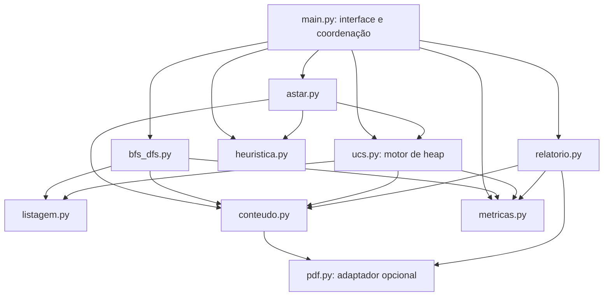
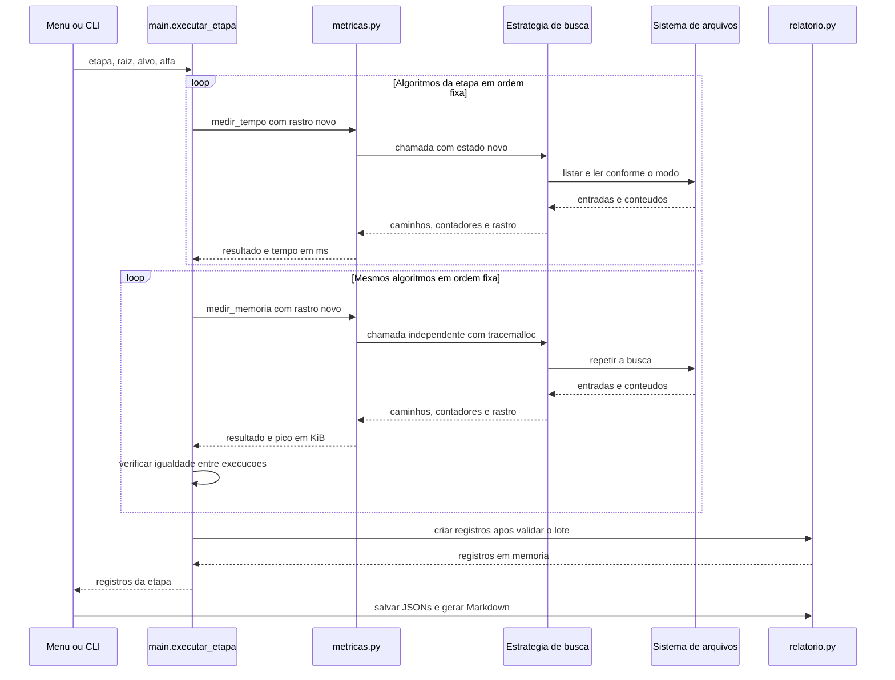

# Arquitetura e modelo computacional

[Apresentação do projeto](../README.md) · [Metodologia experimental](METODOLOGIA.md)

## 1. Caracterização da solução

O File Hunter Agent é uma aplicação modular executada em um único processo.
A organização por responsabilidades permite substituir a política de fronteira
sem alterar os critérios de correspondência, a definição de expansão ou as
unidades das métricas. Os diretórios são representados por caminhos; não existe
uma estrutura persistente de objetos de árvore nem reaproveitamento de classes BST.

As visões seguintes descrevem a implementação existente: modelo do domínio,
dependências entre módulos, estado dos algoritmos e coordenação das medições.
Os contratos operacionais encontram-se em [AGENTS.md](../AGENTS.md), enquanto
as mudanças realizadas estão registradas em [HISTORICO.md](../HISTORICO.md).

## 2. Modelo do espaço de busca

Considere `T = (D, E, r)`, em que `D` é o conjunto de diretórios acessíveis,
`E` representa a relação pai–subdiretório e `r` é a raiz informada. Arquivos
são elementos associados aos diretórios, não estados da fronteira. A exclusão
de symlinks preserva a interpretação usual de árvore com um pai por diretório.
O modelo pressupõe estrutura finita e estática durante as medições.

Seja `I(d)` a listagem elegível de um diretório `d`: arquivos regulares e
subdiretórios, excluídos links e entradas de outros tipos. Expandir `d` significa
obter `I(d)` por `listar_dir`, usando `os.scandir`. A expansão acrescenta uma
unidade a `pastas_abertas` e `|I(d)|` a `itens_examinados`. A ordem fornecida por
scandir não é garantida; a implementação a estabiliza mediante ordenação por
nome ([referência da API](https://docs.python.org/3/library/os.html#os.scandir)).

Um arquivo é descoberto quando aparece na expansão do pai. Na etapa 1, todos
os arquivos descobertos integram o resultado, na ordem de descoberta. Nas buscas
por objetivo, correspondências podem ser descobertas antes da seleção definitiva
do diretório cujo resultado será retornado.

### 2.1. Custos locais e custo do caminho

Seja `P(r,n)` o caminho da raiz até o diretório `n`, incluindo seus extremos.
Os custos adotados são:

```text
c_nome(d)     = |I(d)|
g_nome(n)     = Σ c_nome(d),     para d em P(r,n)

c_conteudo(d) = Σ bytes_lidos(a), para arquivos elegíveis a em d
g_conteudo(n) = Σ c_conteudo(d), para d em P(r,n)
```

O custo inicial anterior à expansão da raiz é zero; após sua expansão, o custo
local da raiz integra g. Todos os custos são não negativos. Diretórios vazios
ou sem arquivos de conteúdo elegível podem ter custo local zero.

O objetivo da etapa 2 é uma substring no nome de um arquivo regular. Na etapa 3,
é uma substring no texto lido ou extraído. Termo e material comparado recebem
`casefold`. A etapa 1 não define objetivo: `custo_g=0` é uma convenção do registro,
não uma afirmação de custo de exploração nulo. A mesma convenção é usada quando
uma busca por objetivo termina sem resultado.

O custo do caminho não corresponde ao trabalho de toda a exploração. Diretórios
de outros ramos também podem contribuir para N, itens, leituras e tempo sem
integrar g do resultado.

## 3. Visão de módulos

O diagrama apresenta dependências entre módulos. As setas indicam uso/importação;
não representam processos, serviços de rede ou execução concorrente.



| Módulo | Responsabilidade | Justificativa da separação |
| --- | --- | --- |
| [main.py](../main.py) | Menu, argumentos, seleção das estratégias e coordenação das medições. | Interface e persistência não determinam a política de exploração. |
| [listagem.py](../funcoes/listagem.py) | Validação de caminhos e listagem ordenada, sem symlinks. | Um contrato de expansão comum evita contagens incompatíveis. |
| [conteudo.py](../funcoes/conteudo.py) | Validação/normalização do alvo, correspondência e custo local. | As estratégias compartilham parâmetros válidos, seleção de formatos e leitura. |
| [pdf.py](../funcoes/pdf.py) | Extração opcional por página e contagem de bytes entregues ao parser. | O tratamento de formato permanece isolado da fronteira. |
| [bfs_dfs.py](../funcoes/bfs_dfs.py) | Fila/pilha, mapeamento integral e busca com objetivo. | A descoberta segue a mesma definição para BFS e DFS. |
| [ucs.py](../funcoes/ucs.py) | Heap, avaliação adiada e seleção de objetivos. | A* reutiliza a implementação de custo e desempate. |
| [heuristica.py](../funcoes/heuristica.py) | Bigramas, Jaccard e preparação do estimador. | O cálculo lexical não realiza acesso ao sistema de arquivos. |
| [astar.py](../funcoes/astar.py) | Validação de alfa e configuração do estimador no motor compartilhado. | g e estimativa permanecem conceitualmente separados. |
| [metricas.py](../funcoes/metricas.py) | Dataclass, instrumentação, rótulos e unidades. | Tempo e memória podem ser medidos sem executar a interface. |
| [relatorio.py](../funcoes/relatorio.py) | Validação, JSON e tabelas Markdown. | Registros permitem reconstruir relatórios sem executar buscas. |
| [gerar_arvore.py](../gerar_arvore.py) | Geração determinística do conjunto didático. | A preparação dos dados independe dos algoritmos. |
| [tests/](../tests/) | Cenários controlados, oráculos e regressões. | A validação considera resultados e invariantes observáveis. |

O relatório importa a configuração de conteúdo e PDF para registrar a política
utilizada. Isso não implica uma nova busca ao converter JSONs. `gerar_arvore.py`
não participa do ciclo de busca ou de medição.

### 3.1. Síntese das decisões de arquitetura

| Escolha | Justificativa | Compromisso e verificação |
| --- | --- | --- |
| Diretórios como nós; caminhos como estado | A fronteira representa pastas a abrir, conforme a definição de expansão. Dispensa classes de BST e uma árvore de objetos duplicando o sistema de arquivos. | Arquivos são descobertos no pai; N corresponde às listagens realizadas. |
| Funções e módulos por responsabilidade | Separa política de busca, acesso a dados, medição e apresentação, mantendo um programa em processo único. | As buscas podem ser verificadas sem menu, persistência ou instrumentação obrigatória. |
| Motores compartilhados e entradas públicas específicas | `_percorrer` atende buscar/mapear com BFS/DFS; `_buscar_prioridade` atende UCS/A*. Evita repetir contadores, visitados e regras de expansão. | O mapeamento continua exclusivo de BFS/DFS. APIs públicas validam o alvo; motores privados recebem termo normalizado. |
| Deque, heap e conjuntos | Cada estrutura atende sua operação central: FIFO/LIFO, menor prioridade e controle de visitados. | DFS inverte a inserção dos filhos; o contador no heap preserva desempates e evita comparação de nós. |
| Scandir ordenado, realpath e exclusão de symlinks | Uma listagem comum e determinística mantém descoberta e custos comparáveis. Visitados impedem repetição. | Ordenar tem custo; verificações pressupõem árvore estática e não impedem trocas concorrentes. |
| Inserção direta na fronteira | Reutiliza a listagem disponível sem criar uma lista adicional de subpastas. Escolhe popleft/pop na inicialização. | Preserva a ordem de descoberta e expansão; verificação antes/depois descrita na metodologia. |
| Avaliação adiada de custos e g separado de f | O custo local exige listagem ou leitura; conhecer esse custo antecipadamente introduziria acessos não contabilizados. | UCS usa limites inferiores e candidaturas confirmadas; A* acrescenta estimativa sem garantia de ótimo. |
| Jaccard de bigramas, sem ML | Fornece orientação lexical determinística usando apenas nome da pasta e termo, sem ler conteúdos para estimar h. | A semelhança não demonstra presença/ausência do alvo; alfa depende da unidade de custo. |
| Leitura em blocos e pasta integral | Limita memória dos textos e mantém o custo local definido por todos os arquivos elegíveis da pasta, mesmo após uma correspondência. | Arquivos lidos na exploração e g do caminho são grandezas diferentes; testes conferem bytes e fronteiras. |
| Adaptador PDF opcional | Isola a dependência externa autorizada, a extração por página e a contagem de bytes entregues ao parser. | Busca por nome permanece independente; não há OCR nem garantia de extração de conteúdo visual. |
| Tempo e memória em chamadas separadas | Evita atribuir a sobrecarga de tracemalloc ao tempo medido. Estado novo preserva a comparação. | Todas as amostras de tempo precedem os perfis; cache e carga ainda afetam o resultado. |
| JSON validado e relatório independente | Preserva parâmetros, métricas e rastros para reconstituir tabelas sem nova busca. | Arquivos exclusivos evitam sobrescrita; não há transação atômica para todo o lote. |
| Dados reproduzíveis, testes e histórico | Cenários determinísticos e oráculos permitem verificar comportamento e justificar mudanças incrementalmente. | Percentuais funcionais não equivalem a cobertura de testes nem a ausência de defeitos. |

A sequência de construção está resumida na
[seção 11 do README](../README.md#11-processo-de-desenvolvimento-e-consolidação).
O histórico identifica implementações, revisões e os experimentos associados;
uma refatoração posterior não altera retroativamente os tempos já publicados.

## 4. Estruturas de dados e políticas de fronteira

### 4.1. BFS e DFS

A fronteira contém pares `(diretorio, custo_do_pai)` em uma `deque`. BFS retira
à esquerda com `popleft()`; DFS retira à direita com `pop()`. Os filhos são
inseridos em ordem inversa no DFS para que irmãos sejam expandidos em ordem
alfabética. As operações nas extremidades são adequadas às políticas FIFO/LIFO
([documentação de deque](https://docs.python.org/3/library/collections.html#collections.deque)).

`buscar` e `mapear` delegam ao mesmo motor privado `_percorrer`. Somente o segundo
fornece `termo=None` para selecionar o mapeamento; esse sentinela não é um alvo
público válido. `validar_busca` exige texto não vazio, valida o modo e retorna
`casefold` antes de acessar a raiz. A* realiza essa validação antes dos bigramas;
os motores privados não repetem a validação do alvo.

O motor escolhe o método de remoção uma vez e insere cada subpasta diretamente
na deque. Para DFS, percorre a listagem em sentido inverso apenas nessa inserção.
Os arquivos do mapeamento são coletados antes, na ordem alfabética da listagem;
seu total é obtido da lista ao concluir. Isso substitui os dois percursos
duplicados por um motor comum e remove a lista temporária de subpastas, sem
mudar a política dos algoritmos.

No mapeamento, a fronteira é esgotada e todos os arquivos são retornados. Com
objetivo por nome, encerra-se após examinar integralmente a pasta objetivo e
retorna-se seu primeiro nome correspondente. Por conteúdo, retornam-se os arquivos
correspondentes dessa pasta, após a leitura dos arquivos elegíveis. Essas políticas
não minimizam g; BFS prioriza profundidade de expansão, e DFS prioriza o ramo atual.

### 4.2. UCS e avaliação adiada

O heap armazena `(prioridade, contador, no)`. O contador é monotônico e resolve
empates por inserção, evitando comparar diretamente os nós, técnica descrita nas
[notas de filas de prioridade](https://docs.python.org/3/library/heapq.html#priority-queue-implementation-notes).

Um diretório possui duas formas operacionais no heap:

| Forma | Representação do nó | Informação conhecida |
| --- | --- | --- |
| Pendente de expansão | `(pasta, None, g_pai)` | Custo até o pai; custo local ainda desconhecido. |
| Objetivo confirmado | `(pasta, correspondencias, g_exato)` | Listagem/leitura concluída e correspondências conhecidas. |

Essa distinção resolve uma restrição do domínio: calcular `len(itens)` exige
abrir a pasta; determinar bytes de conteúdo exige a leitura. Atribuir previamente
esses custos aos filhos demandaria acessos que também deveriam ser contabilizados.

O procedimento pode ser descrito por:

```text
1. Inserir a raiz pendente, com custo anterior igual a zero.
2. Retirar a entrada de menor prioridade.
3. Se for objetivo confirmado, retornar os caminhos e g dessa candidatura.
4. Caso contrário, expandir a pasta e calcular g = g_pai + custo_local.
5. Registrar contadores e, quando solicitado, o rastro da expansão.
6. Havendo correspondências, inserir a candidatura com prioridade g.
7. Sem correspondências, inserir filhos pendentes, com limite inferior g.
8. Repetir até selecionar objetivo ou esgotar a fronteira.
```

**Justificativa de correção de UCS no modelo adotado.** O custo do pai é um
limite inferior para o custo de qualquer objetivo em uma pasta pendente ou em
seus descendentes, pois os custos adicionais são não negativos. Se uma candidatura
de custo C é retirada do heap, não permanece uma entrada com limite inferior
menor que C. Portanto, não pode haver objetivo ainda não selecionado com custo
menor. A conclusão vale para a árvore finita, estática, com custos conforme as
definições anteriores; não afirma que UCS minimiza N ou tempo decorrido.

Ordenar por custo acumulado também não equivale a escolher sempre a pasta com
menor quantidade local de itens. Essa diferença entre a formulação acumulada e
a descrição informal de “pasta mais leve” é um compromisso explícito do projeto.

### 4.3. Heurística e adaptação de A*

Para um texto normalizado com `casefold`, seja `B(s)` o conjunto de bigramas de
caracteres. Um texto de um caractere utiliza esse caractere como token. A
similaridade e a heurística são:

```text
J(A,B) = |A ∩ B| / |A ∪ B|          se a união não for vazia
J(∅,∅) = 1
h(n)   = alfa × [1 − J(B(nome(n)), B(termo))]
```

O nome considerado é o basename do diretório, após normalização do caminho.
O termo representa o alvo do nome na etapa 2 ou a palavra de conteúdo na etapa 3.
Os bigramas do termo são preparados uma vez por busca. Alfa é finito, não negativo
e assume padrão 1; sua escala deve ser interpretada na unidade de g, itens ou
bytes. Não há ajuste automático ou uso de aprendizado de máquina.

Exemplo numérico para o termo `pedagogia`, com alfa=1000, conforme
[heuristica.py](../funcoes/heuristica.py):

| Nome da pasta | Bigramas em comum com o termo | Bigramas na união | Jaccard | h(n) |
| --- | ---: | ---: | ---: | ---: |
| `_planos_pedagogicos_2024` | 7 | 21 | 7/21 = 1/3 | 1000 × (1 − 1/3) ≈ 666,667 |
| `_imagens_auxiliares` | 2 | 24 | 2/24 = 1/12 | 1000 × (1 − 1/12) ≈ 916,667 |

O primeiro nome recebe menor penalidade, embora seu h não seja próximo de zero.
Prefixos, sufixos, sublinhados e números participam dos bigramas: a implementação
não remove esses caracteres nem reconhece sinônimos. Repetições de um mesmo
bigrama contam uma vez, pois B é um conjunto. A consequência sobre expansões e
arquivos lidos é demonstrada com valores observados na
[seção 7.2 da metodologia](METODOLOGIA.md#72-busca-por-conteúdo-e-contraexemplo).

Na avaliação adiada, as prioridades efetivamente usadas são:

```text
UCS: pasta pendente  -> g_pai
A*:  pasta pendente  -> g_pai + h(pasta)
Objetivo confirmado -> g_exato, com h=0 e f=g
```

Logo, `g_pai+h` é a prioridade anterior ao conhecimento do custo local. Ela não
deve ser apresentada como se g da própria pasta já tivesse sido calculado.
Depois da expansão, g exato é registrado no rastro; uma candidatura objetivo
tem estimativa restante zero. A coluna f final corresponde a essa candidatura,
não à heurística lexical que orientava a entrada pendente.

A estimativa lexical **não é admissível em geral**: semelhança de nomes não
estabelece limite inferior para os itens ou bytes necessários até um objetivo.
Aumentar alfa pode favorecer um ramo cujo objetivo seja mais caro. Assim, a
adaptação não oferece garantia de custo ótimo ou de economia de expansões.
Alfa zero reproduz UCS, inclusive desempates e contagens. O contraexemplo e a
demonstração de economia estão em [test_astar.py](../tests/test_astar.py).

### 4.4. Otimização após confirmação local de objetivo

Ao encontrar objetivo em uma pasta expandida, o motor insere sua candidatura,
mas dispensa preparar os descendentes. Um filho teria g pendente igual ao custo
dessa pasta e h não negativo; portanto, sua prioridade não seria menor que a
da candidatura. Em empate, a candidatura já seria inserida antes do filho.
Os descendentes não seriam processados antes da parada nesse objetivo ou em
outro objetivo selecionado previamente pelo heap.

A otimização evita realpaths, estimativas e entradas de heap desnecessárias.
A leitura e a contagem da pasta objetivo continuam integrais, e candidaturas
de outros ramos continuam concorrendo. Ela não representa descarte de pastas
por baixa similaridade. Sem objetivo local, os filhos entram diretamente no
heap, dispensando uma lista intermediária de subpastas.

## 5. Acesso a arquivos e tratamento de formatos

Textos são classificados por extensão em `EXTENSOES_TEXTO`, não por detecção
MIME. A leitura usa UTF-8, `errors="ignore"`, `newline=""` e blocos de 64 Ki
caracteres. A cauda de até `len(termo)-1` caracteres normalizados conserva
correspondências entre blocos, inclusive expansões de `casefold`. Após encontrar
o termo, a leitura prossegue até EOF para preservar o custo integral do arquivo.
O deslocamento binário ao final fornece os bytes consumidos, inclusive CRLF e
sequências ignoradas na decodificação, sem uma segunda leitura para medir custo.

O adaptador PDF abre cada arquivo uma vez e extrai todas as páginas. A pesquisa
equivale a unir os textos extraídos por `\n`, preservando quebras do extrator e
sem acrescentar uma quebra final artificial. O wrapper conta bytes devolvidos
ao parser, inclusive releituras após `seek`. O custo pode, portanto, exceder o
tamanho físico do arquivo.

A extração depende de pypdf opcional. A biblioteca não realiza OCR e pode não
extrair texto de páginas que contenham somente imagens ([referência do extrator](https://pypdf.readthedocs.io/en/stable/user/extract-text.html)).
PDF protegido ou corrompido gera erro explícito. O parser possui estruturas
próprias; o limite de memória em blocos para textos simples não se estende ao PDF.

## 6. Coordenação e fluxo de execução



`executar` reutiliza a mesma coordenação para uma busca individual.
`executar_etapa` e `comparar_conteudo` retornam registros sem gravá-los. O CLI
solicita a persistência depois das medições, salvo quando `--sem-salvar` é usado.
O diagrama representa chamadas sequenciais; a implementação não usa threads.

## 7. Persistência, invariantes e falhas

O esquema JSON v1 inclui parâmetros, caminhos retornados, métricas e métodos
de medição. Campos das etapas registram escopo, experimento, base dos caminhos
e expansões `{diretorio, custo_local, g}`. A cronologia global não é reconstruída
artificialmente para registros antigos de buscas encerradas em um alvo.

| Campo do registro atual | Conteúdo e finalidade |
| --- | --- |
| `versao`, `instante_utc` | Versão do esquema e instante UTC de criação do registro, posterior às medições. |
| `parametros` | Raiz, alvo, algoritmo, modo, alfa, extensões de texto, extrator PDF, escopo e etapa. Alfa é null fora de A*. |
| `encontrados` | Caminhos retornados, distintos do contador de correspondências descobertas. |
| `metricas` | Todos os campos da dataclass, com unidades definidas no protocolo. |
| `medicao` | Métodos, unidades, execuções separadas e contadores por execução. |
| `avaliacao_final` | g, h=0 e f=g para objetivo UCS/A*; null nos demais casos. |
| `base_caminhos` | Diretório de referência para apresentar caminhos relativos. |
| `experimento`, `protocolo_lote` | Identificação comum e ordem das fases nas entregas por etapa. |
| `expansoes` | Cronologia opcional de diretórios, custos locais e g. |
| `primeiros_10` | Projeção dos primeiros arquivos da descoberta global, exclusiva da etapa 1. |

Metadados acrescentados à versão 1 são opcionais para compatibilidade com registros
anteriores. `extensoes_texto` e `extrator_pdf` descrevem a configuração de conteúdo;
no modo nome são null. A origem do arquivo JSON é acrescentada em memória pelo
carregador ou pela interface para a apresentação, sem exigir esse campo nos
registros produzidos por `criar_registro`.

| Invariante | Consequência observável |
| --- | --- |
| Uma listagem por expansão contabilizada | O rastro possui exatamente N entradas. |
| Pai expandido antes do filho | g do rastro soma custo do pai e custo local. |
| Realpath marcado ao inserir na fronteira | Um diretório não é expandido repetidamente na árvore admitida. |
| Mesma definição de correspondência entre estratégias | As diferenças de ordem não decorrem de leitores distintos. |
| Estado novo em cada medição | Os contadores apresentados não somam tempo e memória. |
| Objetivo UCS/A* retirado como candidatura | f final usa h=0; remover a candidatura não é nova expansão. |

Resultados, contadores e rastros são comparados entre as duas execuções.
Divergências impedem produzir os registros do lote. Isso não equivale a um
snapshot: alterações que preservem as observações comparadas podem passar
despercebidas. Erros de acesso e de extração são propagados, evitando apresentar
uma exploração incompleta como resultado concluído.

JSONs usam criação exclusiva e rejeitam números não finitos. Os arquivos são
independentes: não existe transação atômica para a gravação do lote inteiro.
Relatórios validam o esquema, separam configurações incompatíveis e preservam
caminhos relativos à base registrada. A comparação dos primeiros 10 rejeita
BFS/DFS duplicados no mesmo grupo, pois uma coluna deve representar uma execução.

## 8. Análise de custo computacional

Considere D diretórios descobertos, N expandidos, F entradas máximas na fronteira,
R referências de resultados retidas e k entradas elegíveis na pasta corrente.
As ordens seguintes descrevem estruturas em memória, não tempo físico de disco.

| Componente | Ordem de custo relevante |
| --- | --- |
| Listagem e ordenação de uma pasta | O(k) entradas e O(k log k) comparações para ordenar. |
| Inserção/remoção na deque | O(1) nas extremidades. |
| Inserção/remoção no heap | O(log F) por operação. |
| Consulta ao conjunto de visitados | O(1) esperado por chave, além do custo de obter e processar o caminho. |
| Armazenamento de visitados | O(D) referências a caminhos. |
| Rastro solicitado | O(N) registros. |
| Leitura de texto simples | Espaço auxiliar O(b+m), para bloco b e termo normalizado de tamanho m. |

Na exploração completa, a ordenação soma custos de todas as pastas expandidas;
a leitura depende do volume de conteúdo e do trabalho de comparação e sobreposição.
A validação de componentes e `realpath` acrescentam operações dependentes do
comprimento dos caminhos e do sistema de arquivos. PDF acrescenta o trabalho
do parser. Esses componentes impedem reduzir o custo real apenas à política
abstrata de fila ou heap.

Contando referências e registros, o espaço de busca inclui O(D+F+R+N) quando há
rastro, além da listagem corrente, dos buffers e dos conjuntos de bigramas. Os
comprimentos dos caminhos e textos determinam os bytes efetivos. Mesmo DFS pode
reter O(D) diretórios em visitados/fronteira; não se assume memória total limitada
à profundidade. Tracemalloc oferece uma observação empírica dessas alocações,
com o escopo descrito na [metodologia](METODOLOGIA.md).

A revisão do motor BFS/DFS mantém essas ordens assintóticas. A eliminação da
lista temporária reduz referências auxiliares proporcionais aos filhos da pasta
corrente; o mapeamento ainda armazena todos os caminhos descobertos, conforme
exigido. O ganho medido é local e não implica redução geral de tempo ou memória
para qualquer árvore.

## 9. Referências técnicas

As referências fundamentam as APIs utilizadas; o modelo de custos, a avaliação
adiada e os argumentos condicionais acima descrevem a implementação deste projeto.

1. PYTHON SOFTWARE FOUNDATION. [collections — deque](https://docs.python.org/3/library/collections.html#collections.deque). Documentação oficial.
2. PYTHON SOFTWARE FOUNDATION. [heapq — Priority Queue Implementation Notes](https://docs.python.org/3/library/heapq.html#priority-queue-implementation-notes). Documentação oficial.
3. PYTHON SOFTWARE FOUNDATION. [os — scandir](https://docs.python.org/3/library/os.html#os.scandir). Documentação oficial.
4. PYPDF. [Extract Text from a PDF](https://pypdf.readthedocs.io/en/stable/user/extract-text.html). Documentação oficial do projeto.

Os endereços oficiais foram consultados durante esta revisão documental; suas
versões publicadas podem diferir do ambiente local. A especificação do projeto
é o código versionado e a dependência fixada em requirements.txt.
